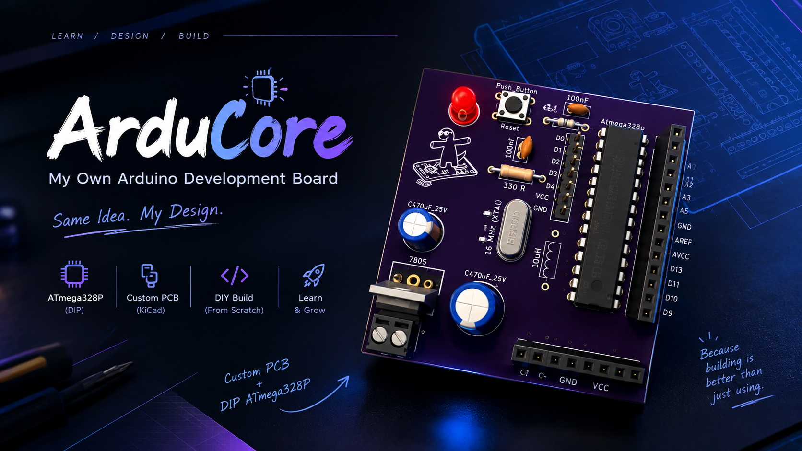
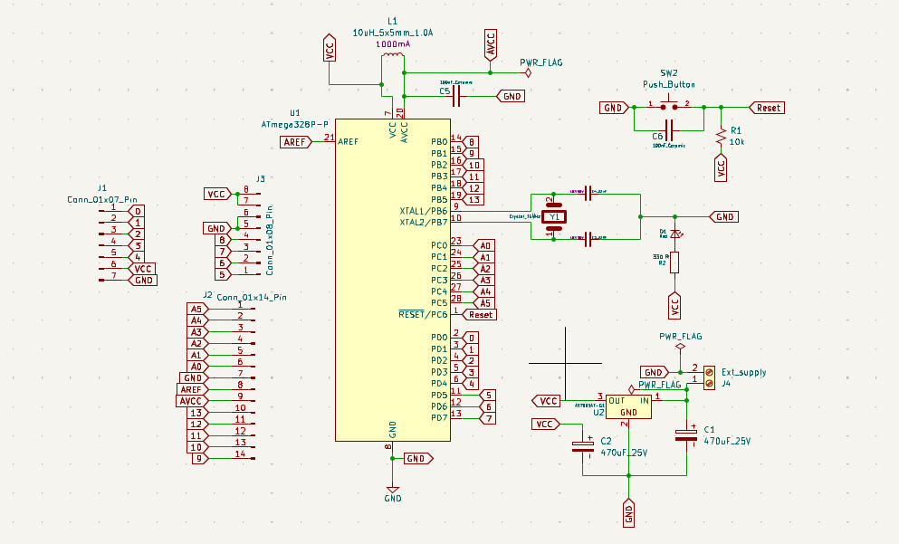
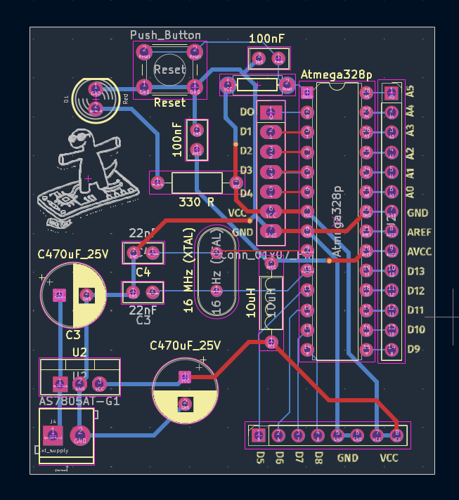
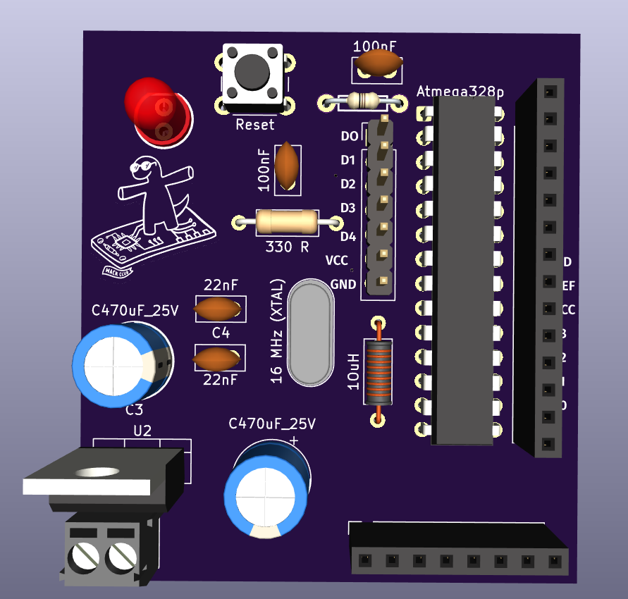

<div align="center">

# ⚡ ArduCore

### My Own Arduino Development Board



<br><br>

**Same idea. My design.**

<br>
</div>

---

### So Why did I make a PCB named ArduCore?

Most of the time, an Arduino is something we plug in and start coding.

I wanted to go one step deeper.

> Instead of using a ready-made Arduino board, I designed the **microcontroller circuit, power section, reset circuit, clock circuit, headers, and PCB layout myself**.

The goal wasn't just to make another Arduino.
> The goal was to understand **why every component exists and how everything works together.**

---

## Features

| Feature | Details |
|---|---|
| Microcontroller | **ATmega328P-PU** |
| Package | **DIP-28** |
| Clock | **16 MHz crystal oscillator** |
| Power Regulation | **7805 linear regulator** |
| Reset | Dedicated push button |
| Indicators | Power / status LEDs |
| I/O | Digital I/O headers |
| Power | External power input |
| PCB | Custom 2-layer PCB |
| Design Tool | KiCad |
| Programming | Arduino ISP |
| USB Programmer | **Not built into the board** |

---

# And How does it Work ?

At the heart of ArduCore is the **ATmega328P**.

```bash
                    ┌───────────────────────┐
                    │       ArduCore        │
                    │                       │
                    │    ATmega328P-PU      │
                    │                       │
                    └───────────┬───────────┘
                                │
             ┌──────────────────┼──────────────────┐
             │                  │                  │
             ▼                  ▼                  ▼
        ┌─────────┐       ┌──────────┐       ┌─────────┐
        │  Clock  │       │  Reset   │       │  Power  │
        │ 16 MHz  │       │ Circuit  │       │  7805   │
        └─────────┘       └──────────┘       └────┬────┘
                                                   │
                                                   ▼
                                             ┌──────────┐
                                             │  +5 V    │
                                             └──────────┘
                                                   │
                                                   ▼
                                            ATmega328P
                                                   │
                            ┌──────────────────────┼───────────────────┐
                            ▼                      ▼                   ▼
                       Digital I/O             LEDs              Headers
```

---

# Hardware Design

## Microcontroller

The main controller is: **ATmega328P-PU — DIP-28**
> The DIP package makes the microcontroller easy to remove, replace, and experiment with.

## Clock Circuit

ArduCore uses a: **16 MHz crystal oscillator**
> This provides the clock source required for the ATmega328P to operate in the Arduino-style configuration.

## Reset Circuit
A dedicated push button provides manual reset functionality.
> Pressing the button resets the ATmega328P and allows the board to restart.

## Power Section

The board uses a: **7805 linear voltage regulator**
> The power section also includes bulk and decoupling capacitors to help stabilize the supply.

## I/O Headers

> The ATmega328P's available I/O pins are brought out to headers so the board can be used with external electronics projects.

---
### Schematic


<br><br>

### PCB Layout


<br><br>

### 3D PCB View


</div>

---

## Block Diagram

```bash
       External Power
             │
             ▼
      ┌──────────────┐
      │     7805     │
      │   Regulator  │
      └──────┬───────┘
             │ +5V
             ▼
      ┌──────────────┐
      │  ATmega328P  │
      │              │
      │    DIP-28    │
      └──────┬───────┘
             │
      ┌──────┼───────────────┐
      │      │               │
      ▼      ▼               ▼
   GPIO    Crystal          Reset
 Headers    16MHz           Button
      │
      ▼
 External
  Modules
```

---

## Programming

### Arduino ISP
ArduCore does **not** contain a dedicated USB-to-Serial programmer.
> Instead, another Arduino can be used as an **ISP programmer**.

```bash
┌───────────────────────┐
│   Arduino Programmer  │
│                       │
│     ArduinoISP        │
└───────────┬───────────┘
            │
            │ ISP
            │
            ▼
┌───────────────────────┐
│       ArduCore        │
│                       │
│     ATmega328P        │
└───────────────────────┘
```

### Detailed instructions:
[`Programming ArduCore with Arduino ISP`](documentation/Arduino-ISP.md)

---

## 🎥 Project Demo

Yet to be implemented 

---

## Manufacturing

Manufacturing files are available in:

```bash
production/gerbers/
```

### Gerber Package
[`ArduCore-Gerbers.zip`](production/gerbers/ArduCore-Gerbers.zip)

---

## Bill of Materials
The complete component list is maintained in:

```bash
production/bom/
```

### BOM
[`ArduCore-BOM.csv`](production/bom/ArduCore-BOM.csv)

---
## Grant Budget ($25 B-Tier)

This project is submitted under the **A-Tier ($120 max)** hardware grant for custom development boards.

### Cost Breakdown

| Item | Description | Estimated Cost |
| :--- | :--- | :--- |
| **PCB Fabrication** | Custom 2-layer PCB (5 pcs) via JLCPCB | ~$2.00 |
| **Shipping & Handling** | Standard global shipping for manufactured PCBs | ~$10.50 |
| **Component BOM** | ATmega328P-PU, 16 MHz Crystal, 7805 regulator, THT passives, switches, & pin headers | ~$6.50 |
| **Total Requested** | | **$19.00** |


## Repository Structure

```bash
ArduCore/
│
├── assets/
│   ├── ArduCore_Banner.png
│   ├── ArduCore_PCB.png
│   ├── ArduCore_3D_PCB.png
│   └── ArduCore_Schematics.png
│
├── documentation/
│   └── Arduino-ISP.md
│
├── pcb/
│   ├── ArduCore.kicad_pcb
│   ├── ArduCore.kicad_pro
│   └── ArduCore.kicad_sch
│
├── production/
│   ├── bom/
│   │   └── ArduCore-BOM.csv
│   │
│   └── gerbers/
│       ├── ArduCore-Gerbers.zip
│       ├── *.gbr
│       └── *.drl
│
├── LICENSE
├── README.md
└── .gitignore
```

---

## Tools Used
1. Kicad
2. Arduino IDE
3. Atmega328p
4. Github

---

## What I Learned

This project taught me much more than just making a PCB.
### Hardware

- ATmega328P architecture
- MCU pin functions
- Crystal oscillator circuits
- Reset circuitry
- Voltage regulation
- Decoupling capacitors
- GPIO routing

### PCB Design
- Schematic capture
- Footprint selection
- PCB placement
- Trace routing
- Ground planes
- Design Rule Checking
- Gerber generation
- Manufacturing preparation

### Embedded

- Arduino ISP
- Bootloader programming
- ATmega328P programming
- Understanding what happens underneath a development board


---


--- This project started with a simple question ---

> **"What's actually inside an Arduino?"**


### Build it. Break it. Understand it. Improve it.
