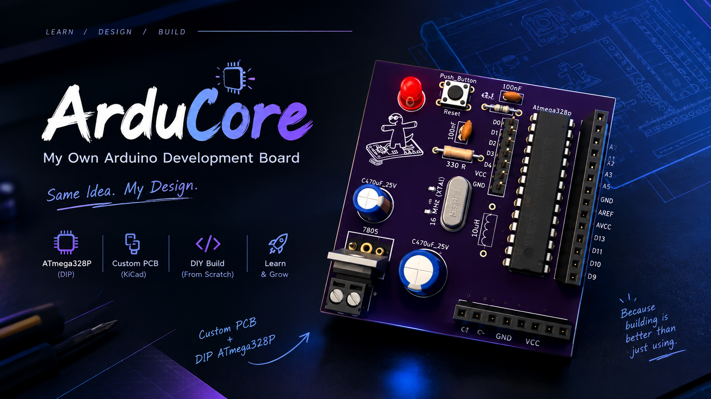
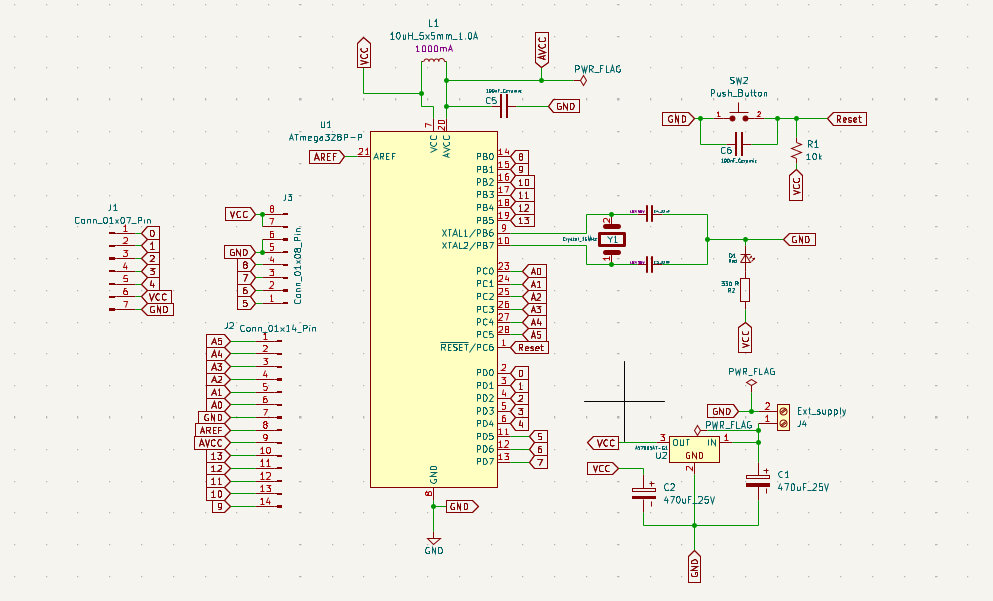
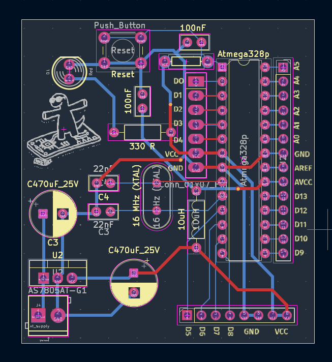
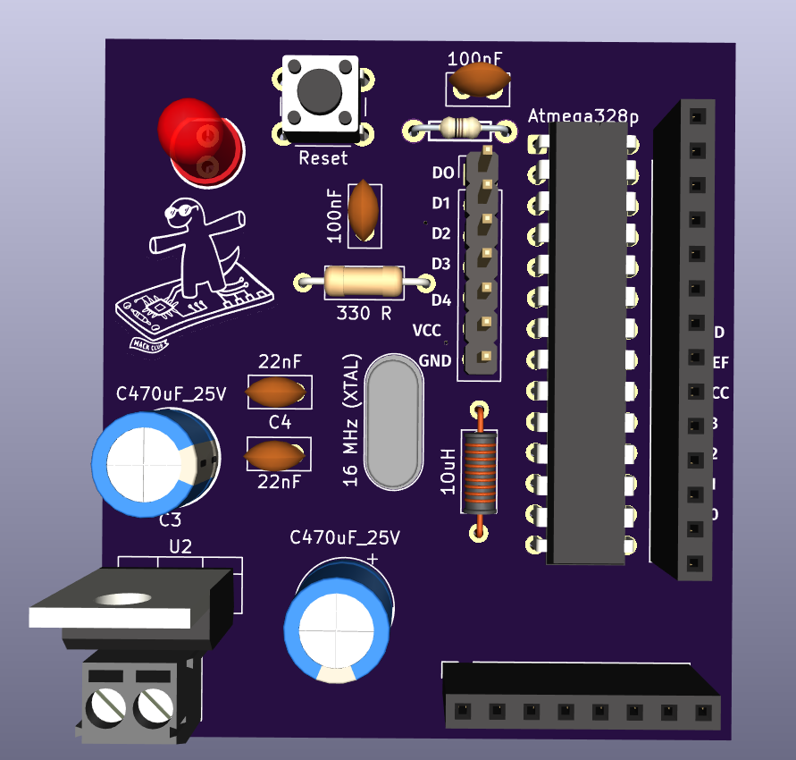

<div align="center">

# ⚡ ArduCore

### My Own Arduino Development Board



</div>

---

### So Why did I make a PCB named ArduCore?

I wanted to go one step deeper.

> Instead of using a ready-made Arduino board, I designed the **microcontroller circuit, power section, reset circuit, clock circuit, headers, and PCB layout myself**.

> I wanted my own Arduino Devboard so made this project 

---
### Schematic


<br><br>

### PCB Layout


<br><br>

### 3D PCB View


</div>
---
## Programming

### Arduino ISP
ArduCore does **not** contain a dedicated USB-to-Serial programmer.
> Instead, another Arduino can be used as an **ISP programmer**.

```bash
┌───────────────────────┐
│   Arduino Programmer  │
│                       │
│     ArduinoISP        │
└───────────┬───────────┘
            │
            │ ISP
            │
            ▼
┌───────────────────────┐
│       ArduCore        │
│                       │
│     ATmega328P        │
└───────────────────────┘
```

### Detailed instructions:
[`Programming ArduCore with Arduino ISP`](documentation/Arduino-ISP.md)

---

## 🎥 Project Demo

Yet to be implemented 

---

## Manufacturing
Manufacturing files are available in:

```bash
production/gerbers/
```

### Gerber Package
[`ArduCore-Gerbers.zip`](production/gerbers/ArduCore-Gerbers.zip)

---

## Bill of Materials
The complete component list is maintained in:

```bash
production/bom/
```
### BOM
[`ArduCore-BOM.csv`](production/bom/ArduCore-BOM.csv)

---
## Grant Budget ($25 B-Tier)

This project is submitted under the **B-Tier ($25 max)** hardware grant for custom development boards.

### Cost Breakdown

| Item | Description | Estimated Cost |
| :--- | :--- | :--- |
| **PCB Fabrication** | Custom 2-layer PCB (5 pcs) via JLCPCB | ~$2.00 |
| **Shipping & Handling** | Standard global shipping for manufactured PCBs | ~$10.50 |
| **Component BOM** | ATmega328P-PU, 16 MHz Crystal, 7805 regulator, THT passives, switches, & pin headers | ~$6.50 |
| **Total Requested** | | **$19.00** |

---

## Tools I Used
1. Kicad
2. Arduino IDE
4. Github


--- This project started with a simple question ---

> **"What's actually inside an Arduino?"**

### Build it. Break it. Understand it. Improve it.
